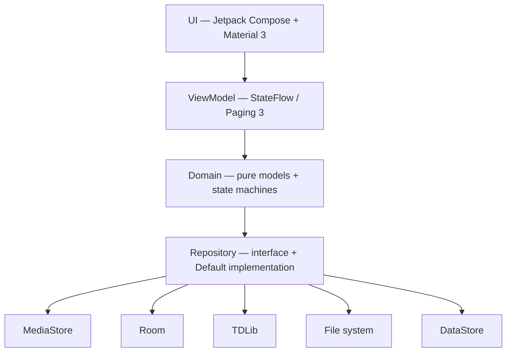
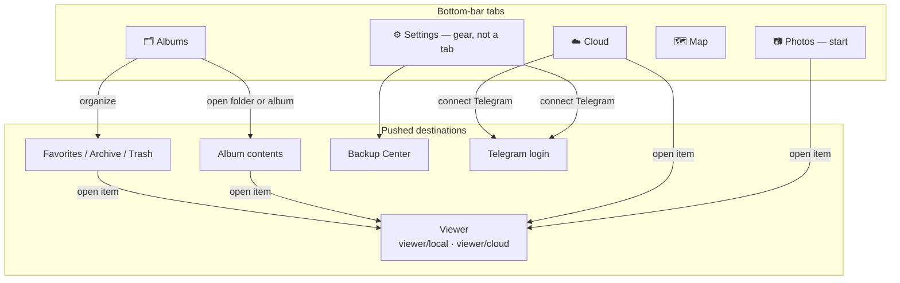
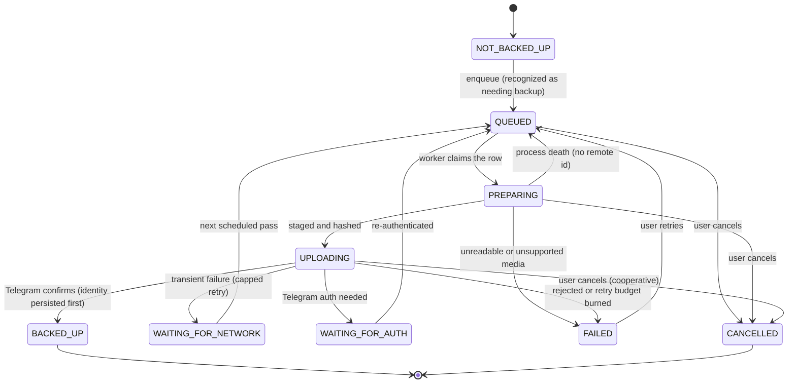

<div align="center">

**A local-first Android photo & video library with Telegram-powered cloud backup.**

[](https://github.com/FakeAbid11/Telepic/actions/workflows/android-ci.yml)
[](LICENSE)
[](#quick-start)
[](#configuration)
[](#architecture)
[](#architecture)
[](#limitations)
[](#project-status)

Telepic reads your device library through `MediaStore` and presents it as a fast, beautiful timeline. It backs your media up to a **private Telegram channel** and lets you browse that cloud library by *preview* — originals are downloaded only when you explicitly ask for them.

</div>

---

## 📑 Contents

- [✨ Features](#features)
- [🚀 Quick start](#quick-start)
- [🧭 Usage](#usage)
- [⚙️ Configuration](#configuration)
- [🏗 Architecture](#architecture)
- [🗺 Navigation](#navigation)
- [🔁 Backup engine](#backup-engine)
- [📊 Project status](#project-status)
- [⚠️ Limitations](#limitations)
- [🧪 Testing](#testing)
- [🤝 Contributing](#contributing)
- [📄 License](#license)
- [🙏 Acknowledgements](#acknowledgements)

---

<a id="features"></a>
## ✨ Features

### 🖼 Library & timeline
- Reads photos, videos, and GIFs from `MediaStore` as one newest-first, paged stream (no full-library scans in memory).
- Adaptive, thumbnail-first grid with stable keys; full-resolution originals are never decoded for the grid.
- Localized relative day headers (Today / Yesterday / weekday / date) resolved in the device time zone.
- Right-side date rail built from the loaded days only — it grows with paging and never force-loads the library.
- Backup status badges (queued / uploading / backed up / failed) from one batched repository snapshot; no per-tile queries.

### 🎥 Viewer
- Full-screen viewer for photos, videos, and GIFs with pinch-to-zoom, pan, and double-tap reset.
- Previous/next navigation stays within the originating collection (local or cloud).
- Videos play via Media3 ExoPlayer; animated GIFs decode via Coil.
- Honest "no longer available" state — a missing item is never silently replaced by another.

### 🗂 Albums & organization
- **Your own albums**, created from the Albums tab and filled from the Photos timeline: name them, add photos, rename or delete them. The album is the list of media you chose, so it survives a folder being renamed and is never affected by the filesystem.
- Folder albums built from real MediaStore buckets (newest item as cover, real counts, provider bucket names), shown in the same grid under **Device folders**.
- Album contents reuse the exact Photos pipeline, so an album behaves identically to the timeline.
- Favorites, Archive, and Trash per item - independent of backup state, with undo.
- Bulk actions on a selection: back up, add to an album, favourite, or move to trash - with a count, an Undo, and a confirmation before anything is hidden.
- Permanent delete goes through the Android-sanctioned system consent dialog: `MediaStore.createDeleteRequest` on API 30+, and the platform's own recoverable-consent prompt on Android 10, so the feature works on every supported release.

### 🗺 Map
- Interactive OpenStreetMap view (osmdroid, no API key) with marker clustering.
- Photo positions come only from embedded EXIF GPS. **No device-location permission is requested, and no coordinates or EXIF are ever uploaded.**

### 💾 Backup
- Persistent backup queue in Room that survives process death, restart, and reboot.
- Explicit state machine: nothing reaches `BACKED_UP` without a confirmed remote identity from Telegram, enforced in the queue's SQL state guards.
- Crash recovery, bounded retry, cooperative cancellation, and safe app-private staging (originals are never modified or deleted).
- WorkManager-driven with a foreground notification and a network constraint; uploads resume on reconnect.
- **Content-based deduplication** — streaming SHA-256 identity, so the same bytes are never uploaded twice. The hash rides in the message caption, so the manifest rebuilt after a reinstall recognises the channel's contents rather than re-uploading them.

### ☁️ Cloud (Telegram)
- Browse your backed-up media by preview without downloading originals.
- Destination discovery/creation, with posting rights taken from real chat membership — never the channel title.

### ↩️ Restore
- Explicit "Save to device" that downloads an original, verifies it, and publishes it into the public gallery.

### 🔐 Onboarding, permissions & theming
- Six-step first-run onboarding with persistent state.
- Version-aware media permissions (Android 13+ granular, Android 14 partial "selected photos", legacy storage below) with honest granted / partial / denied / permanently-denied states.
- Dark (default), Light, and System themes, all driven by centralized design tokens.
- Accessibility-minded: merged content descriptions, labeled actions, and Material-standard touch targets.

### ⚙️ Settings, details & security
- Backup transport controls — Wi-Fi only, charge only, battery-not-low — enforced as WorkManager constraints, so a run simply does not start until the condition holds rather than failing.
- Media preferences — show/hide videos and GIFs in the library views (backups unaffected), and whether videos start muted.
- Media Details for both local and cloud items: kind, format, dimensions, size, duration, folder/path, capture time, camera, the EXIF exposure set (ISO / aperture / shutter / focal length), GPS, backup status and remote identity — with every unavailable field omitted rather than guessed.
- App lock behind your device PIN/pattern/password, with an honest "unavailable" state on a device that has no credential.
- Local and cloud library counts, measured cache sizes with safe cache clearing, and an open-source licence list.

---

<a id="quick-start"></a>
## 🚀 Quick start

### 📋 Requirements

**To install and use the app**
- An **ARM** Android device (`arm64-v8a` or `armeabi-v7a`) running **Android 8.0 (API 26) or newer**.
- A Telegram account, if you want cloud backup.
- No Google account, and no device-location permission, is required.

**To build or contribute**
- **No local toolchain is required.** The canonical build runs in **GitHub Actions** — you do not need Android Studio, Gradle, or the Android SDK installed to produce an APK.
- A GitHub account, to run the workflow.
- Telegram API credentials for a login-capable build (see [Configuration](#configuration)). Main/manual CI debug builds use them; pull-request builds stay credential-free.

### 💾 Install the prebuilt debug APK (recommended)

Every push to `main` produces a debug APK as a CI artifact.

1. Open the repository's **Actions** tab.
2. Select the latest successful run on `main`.
3. Scroll to **Artifacts** and download **`telepic-debug-apk`**.
4. Unzip it and install the APK on your device. You may need to allow *Install unknown apps* for your file manager or browser.

> The APK is a **debug** build and is not signed for distribution. Main/manual CI builds include the
> repository's Telegram credentials so login works out of the box. **This repository is public**, so
> anyone who downloads that artifact can extract the `api_hash`; rotate the Telegram API credentials
> if that becomes a problem. Pull-request artifacts are built without credentials.

### 🔨 Build it yourself through CI

1. **Fork** the repository (or clone it and push to your own remote).
2. Add the Telegram credentials if you want the normal debug APK to be login-capable — see [Configuration](#configuration).
3. Trigger a build by pushing a commit, opening a pull request, or using **Actions → Debug → Run workflow** (`workflow_dispatch`).
4. Download the **`telepic-debug-apk`** artifact from the finished run. On `main`/manual runs it is login-capable; PR artifacts are credential-free.

### ✅ Verify Telegram login on a device

<details>
<summary>Real-device login is a manual, one-time check</summary>

1. Install the APK and complete onboarding.
2. On the **Telegram Login** step, enter your phone number, the login code, and (if enabled) your 2FA password.
3. Confirm the authorized state, restart the app (the session should persist), and test logout / re-login.

</details>

---

<a id="usage"></a>
## 🧭 Usage

Telepic is an app, not a library, so "usage" is a walkthrough of the main flows.

**1. First launch — onboarding**
Complete the six steps: Welcome → How Telepic Works → Permissions → Telegram Login → Backup Preferences → Ready. Granting media access is what populates the timeline; Telegram login is optional and only needed for cloud features.

**2. Browse your library**
Open **Photos** for the full timeline, or **Albums** to browse by folder. Scroll to page through media, tap the date rail to jump between days, and pull to refresh after adding media outside the app.

**3. Turn on backup**
Choose a backup mode during onboarding or later in **Settings → Backup**:
- **Back up all photos and videos** — discovers and uploads eligible media automatically.
- **Select a folder** — opens a picker listing the device's actual media folders; only the folders you tick are scanned and uploaded. Confirm requires at least one folder, and nothing else is uploaded automatically.
- **Not now** — never uploads automatically.

Use **Back up now** to scan for new media immediately, and **Backup Center** to watch progress, retry, or cancel individual items.

**4. Browse the cloud**
Open **Cloud** to see everything already backed up in your Telegram channel. Tiles load **previews** on demand — browsing never downloads originals.

**5. View and restore**
Tap any photo or video to open the full-screen viewer. For a cloud item, use **Download** to fetch the original for viewing, or **Save to device** to download it, verify it, and publish it into your gallery.

**6. Organize**
In the viewer, mark items as **favorite**, **archive**, or move them to **trash**. Favorites / Archive / Trash are reachable from Albums. Archive hides an item from the main timeline without deleting it; permanent deletion asks for system consent first.

**7. Map your photos**
Open **Map** to see photos that carry EXIF GPS coordinates. Media without location data simply never gets a pin — nothing is guessed.

**8. Settings**
Tap the **gear in the top-right corner** — available on every tab — for account and connection state, backup preferences, transport and media options, the app lock, theme, storage usage, and sign-out.

---

<a id="configuration"></a>
## ⚙️ Configuration

### GitHub Actions secrets

Configure these under **Settings → Secrets and variables → Actions**. Main/manual debug CI builds
read them so the normal APK is login-capable; pull-request builds deliberately do not receive them.
This repository is public, so the `api_hash` in a downloaded main debug APK is extractable.

| Secret | Required | Purpose |
|---|---|---|
| `TELEGRAM_API_ID` | For login | Numeric API id from your [Telegram developer account](https://my.telegram.org). Injected into `BuildConfig`. |
| `TELEGRAM_API_HASH` | For login | API hash string. Injected into `BuildConfig`. |

**Secrets are never committed, hardcoded, or logged.** A non-numeric `TELEGRAM_API_ID` fails fast
rather than silently becoming `0`.

### Local credentials and build

```bash
export TELEGRAM_API_ID=123456
export TELEGRAM_API_HASH=0123456789abcdef0123456789abcdef
./gradlew assembleDebug
```

### Build configuration

Defined in [`app/build.gradle.kts`](app/build.gradle.kts):

| Setting | Value |
|---|---|
| `applicationId` / `namespace` | `com.telepic` |
| `minSdk` | 26 (Android 8.0) — required by the TDLib artifact |
| `targetSdk` / `compileSdk` | 36 (Android 16) |
| ABI filters | `arm64-v8a`, `armeabi-v7a` (x86/x86_64 excluded) |
| Java / Kotlin target | 17 |
| Release build | R8 minification + resource shrinking, with project ProGuard rules |
| Lint | `abortOnError = true` |

Dependency versions are centralized in [`gradle/libs.versions.toml`](gradle/libs.versions.toml).

### In-app settings

| Setting | Location | Options |
|---|---|---|
| Theme | Settings → Appearance | Dark (default), Light, System default |
| Backup mode | Settings → Backup | Back up all photos and videos / Select a folder / Not now |
| Manual backup | Settings → Backup | **Back up now** (enabled once a backup mode is configured) |
| Cache | Settings → Storage | Measured Telegram session and staging cache sizes; **Clear backup cache** |
| Account | Settings → Account | Telegram account, connection state, backup channel, sign-out |

---

<a id="architecture"></a>
## 🏗 Architecture

Telepic is a **single-module, single-activity** app with a **layered, unidirectional** data flow:



- **UI** is 100% Jetpack Compose + Material 3 — there are no XML layouts.
- **Dependency injection** is a small hand-written container ([`di/AppContainer.kt`](app/src/main/java/com/telepic/di/AppContainer.kt)) using `by lazy` singletons — no Hilt or Koin. It is deliberately shaped so a future DI framework can be introduced without touching callers.
- **Every repository is an interface with a `Default*` implementation**, which is the seam the test suite substitutes.

### Tech stack

| Area | Choice |
|---|---|
| Language | Kotlin |
| UI | Jetpack Compose + Material 3 (Material You) |
| Async | Kotlin Coroutines + Flow / StateFlow |
| Navigation | Navigation for Compose, with a typed `MediaSource` across the viewer boundary |
| Local media | Android `MediaStore` + Paging 3 |
| App-data storage | Room (KSP) |
| Settings storage | Jetpack DataStore (Preferences) |
| Image loading | Coil — thumbnail-first, video-frame decoding, animated GIFs |
| Video playback | Media3 ExoPlayer |
| Map | osmdroid + OpenStreetMap tiles (Apache-2.0, no API key) |
| EXIF / GPS | `androidx.exifinterface` |
| Recognition / dedup | Streaming SHA-256 via `MessageDigest` (no third-party hashing library) |
| Cloud backend | Telegram via Java TDLib (`org.drinkless.tdlib`), ARM-only |
| Background work | WorkManager, with a foreground backup worker |

### Project structure

```
app/src/main/java/com/telepic/
├── MainActivity.kt                 # Single-activity Compose host
├── TelepicApplication.kt           # Owns the DI container + Coil image loader
├── di/                             # Lightweight manual dependency container
├── navigation/                     # Destinations, NavHost, typed viewer routes
├── domain/
│   ├── media/                      # LocalMedia, MediaType, PhotosItem, day grouping
│   ├── cloud/                      # CloudMedia, destination, status, upload contract
│   └── backup/                     # BackupState + BackupItem, recognition
├── data/
│   ├── media/                      # MediaStore loader, mapper, PagingSource, repository, observer
│   ├── cloud/                      # Cloud repository, TDLib data source, Room (destination/manifest)
│   ├── backup/                     # Queue, coordinator, repository, staging, WorkManager
│   │   ├── hash/                   # Streaming SHA-256 ContentHasher
│   │   ├── db/                     # backup_queue entity + DAO (content-hash indexed)
│   │   └── work/                   # BackupWorker, scheduler, worker factory
│   ├── organization/               # Favorites / Archive / Trash state + local deleter
│   └── restore/                    # Restore pipeline + MediaStore publisher
├── onboarding/                     # BackupPreference, repository, ViewModel, startup routing
├── permissions/                    # SDK-aware media-permission policy + controller
├── settings/                       # ThemeMode, repository, ViewModel (DataStore)
├── telegram/                       # TDLib controller, session manager, gateway, key, states
└── ui/
    ├── TelepicRoot.kt              # Startup routing: onboarding vs main app
    ├── TelepicApp.kt               # Scaffold + bottom navigation
    ├── theme/                      # Design system: Color, Type, Shape, Spacing, Theme
    ├── components/                 # Reusable Empty / Loading / Error / Header components
    ├── onboarding/                 # OnboardingScreen, steps, reusable components
    └── screens/                    # photos, cloud, albums, map, settings, viewer, backup, organization
```

### Database

Room is at **version 12**, with explicit migrations and **no destructive fallback**:

| Table | Purpose | Introduced |
|---|---|---|
| `cloud_destination` | The single validated Telepic Backup channel, owned by a Telegram account id | v1 (owner added 11 → 12) |
| `cloud_media_manifest` | Cloud media index, keyed by `chatId + messageId` | v1 |
| `backup_queue` | Source of truth for backup state | 1 → 2 |
| `media_organization` | Favorites / Archive / Trash state | 3 → 4 |
| `media_location` | EXIF-GPS location cache | 4 → 5 |
| `custom_album` | User-created albums: name + cover hint | 6 → 7 |
| `custom_album_media` | Album membership, keyed `(albumId, localMediaId)`, cascading on delete | 6 → 7 |
| `media_location_scan` | Which items the map has already examined for GPS — including those that carry none | 7 → 8 |

Migrations are `1 → 2`, `2 → 3`, `3 → 4`, `4 → 5`, `5 → 6`, `6 → 7`, `7 → 8`, `8 → 9` (index-only), `9 → 10` (adds `cloud_media_manifest.contentSizeBytes`), `10 → 11` (adds `backup_queue.pendingWaitAttempts`, the durable pending-send wait cap) and `11 → 12` (adds the nullable `cloud_destination.accountId`; existing rows are adopted by the first authenticated account rather than guessed). Migration tests build a previous version with raw SQL and reopen the real database, so Room validates the result against the compiled entities. `TelepicDatabase` is always the latest version, so a version bump touches every chained test; the `9 → 10` and `11 → 12` steps are currently covered transitively rather than by a test starting at exactly v9/v11.

The schema JSON Room exports per version lives in `app/schemas/`, and CI uploads it as the
`telepic-room-schemas` artifact. Baselines are committed from **v9 onward**; versions 1–8 predate the
exported baseline and are reconstructed from the migration tests. **A new schema JSON must be
committed with the migration that produced it**: the migration tests themselves build the previous
version with raw SQL, so Room's runtime validation does not read the JSON.

---

<a id="navigation"></a>
## 🗺 Navigation

One activity, one flat back stack: four bottom-bar tabs plus **Settings** (reached from the gear on
every tab), and detail screens pushed on top of whichever screen opened them — so system Back always
returns to the originating context.



Route strings have exactly one owner each: tab routes live on the `TelepicDestination` enum, and each
parameterised destination owns its pattern, argument keys, and builders in its own object
(`ViewerRoute`, `AlbumRoute`, `OrganizationRoute`, `BackupCenterRoute`, `TelegramLoginRoute`). The
viewer namespace is spelled once as `ViewerRoute.PREFIX`, which both the patterns and the app shell's
chrome-fade match against — pinned by `RouteContractTest`.

---

<a id="backup-engine"></a>
## 🔁 Backup engine

The queue in one picture — an item's life from enqueue to confirmed backup:



- **Core invariant:** nothing reaches `BACKED_UP` except from `UPLOADING`, and the remote identity
  (`chatId` + `messageId`) is persisted in the same SQL statement as the state — no success is ever
  claimed on a guess.
- **Durable wait cap:** a parked transient failure counts its attempts in the row itself
  (`pendingWaitAttempts`, migration 10 → 11), so restarting the process cannot reset the retry budget.
- **WorkManager-driven** with a network constraint and an honest foreground notification; offline
  rows simply resume when the connection returns.
- **A long library drains inside one run.** The worker processes the queue in batches and keeps
  going while there is work, so a ten-thousand-item library is not throttled by WorkManager's
  exponential backoff between batches. The backoff is reserved for an item that genuinely keeps
  failing.
- **Content-hash dedup** (streaming SHA-256) means identical bytes reached through two local ids are
  never uploaded twice. A backup pass first rebuilds the manifest from the channel's history
  (recovering each hash from its message caption), and the upload path re-checks the manifest right
  before sending — so a reinstall recognises the channel's existing contents instead of uploading a
  second copy.

The full phase-by-phase history of the engine (staging, crash recovery, recognition, folder picker)
is in [docs/development-history.md](docs/development-history.md).

---

<a id="project-status"></a>
## 📊 Project status

Telepic is a **debug-milestone** project. Every feature is implemented and verified by CI (compile +
unit tests + lint), but the Telegram and device-bound surfaces have **not** been exercised on a real
device yet.

| Feature | Status |
|---|---|
| Onboarding (6 steps) | Complete |
| Version-aware media permissions | Complete |
| Photos timeline (adaptive grid, day headers, date rail, paging) | Complete |
| Backup status indicators | Complete *(real-upload path device-gated)* |
| Albums + album contents | Complete |
| User-created albums (create / add / rename / delete) | Complete |
| Full-screen viewer (photo / GIF / video) | Complete *(playback device-validated only)* |
| Map (EXIF GPS, marker clustering) | Complete *(rendering device-validated only)* |
| Favorites / Archive / Trash | Complete *(system delete consent device-validated only)* |
| Telegram authentication (TDLib) | Code complete *(live login device-gated)* |
| Cloud browse + preview | Code complete *(live calls device-gated)* |
| Backup engine (queue, WorkManager) | Code complete *(live upload device-gated)* |
| Recognition & deduplication (SHA-256) | Code complete *(remote half device-gated)* |
| Restore / save-to-device | Code complete *(download + MediaStore write device-gated)* |
| Settings | Complete *(app lock + cache clearing device-gated)* |
| Media Details | Complete |
| Search (file name & folder, in Photos) | Complete |
| App lock | Complete *(device-credential prompt device-gated)* |

<a id="device-validation-status"></a>
### Device validation status

Telepic is built and unit-tested entirely in CI, but its Telegram and device-bound surfaces can only
be verified on a **real ARM device with an authenticated Telegram session**. None of the following has
been performed yet — in every case the code path exists and is unit-tested with fakes, but it has
never run against the real thing.

| Surface | Why it is device-gated |
|---|---|
| TDLib request/response shapes | Written against `io.github.tdlib-android:core:0.1.1` (TDLib 1.8.x); the generated `TdApi` surface must be finalized on-device |
| Telegram auth round-trip | Needs a real phone number, code, and optional 2FA — or, for an account registered by email, the emailed code (and possibly a Telegram Premium purchase) |
| Cloud browse / preview / original download | Needs a populated channel and a live session |
| Backup upload (`SendMessage` + `InputFile`) | The upload path is implemented (`TdLibCloudDataSource.upload` sends the staged file and polls the sent message's sending state); a live send against a real session is what remains unverified. An item stays `QUEUED`/`WAITING` on a transient failure and is never marked `BACKED_UP` without a confirmed remote identity |
| MediaStore write (restore) and delete consent | Provider behaviour and the system consent dialog are device-only |
| ExoPlayer playback, osmdroid rendering, Coil GIF decode | Rendering is device-only |
| App lock (`KeyguardManager` device-credential prompt) | The credential prompt and the activity `ON_STOP`/`ON_START` round trip are device-only |

### Roadmap

Next up: **full-device validation of the code-complete work through Phase 14**, plus date and place search.

The chronological phase-by-phase log lives in [**docs/development-history.md**](docs/development-history.md).

---

<a id="limitations"></a>
## ⚠️ Limitations

- **Device validation is outstanding.** The entire live Telegram path (auth, cloud browse/preview, upload, download), MediaStore write/delete consent, all rendering (ExoPlayer, osmdroid, GIF decode), and the app lock's credential prompt are unverified on a device. See [Device validation status](#device-validation-status).
- **App lock re-locks on a grace window, not instantly.** Returning to the foreground within 30 seconds does not re-prompt, because launching a system activity (the photo picker, the delete-consent dialog, the Telegram link) stops this activity and an instant re-lock would interrupt the user's own flow. It locks on cold start and after longer background trips; see `AppLockTimer` for the exact rule.
- **Reinstall recognition cannot cover media backed up by a build without the caption marker.** Those manifest rows carry no hash, so only the kinds Telegram gives a filename to (videos, GIFs, documents) can be recovered by name and size; photos backed up by such a build are re-uploaded once and then carry the marker themselves.
- **Hiding videos or GIFs does not change what gets backed up.** The Media preferences filter the library *views* only; backup eligibility stays governed by the backup preference. The folder picker therefore lists folders by what a backup would take, not by what the timeline happens to show.
- **No instrumented tests, and no emulator job in CI.** All tests are JVM/Robolectric; there is no `app/src/androidTest` source set, and an emulator running on every push was deliberately deferred — it would multiply CI minutes for coverage the JVM suite largely overlaps. Nothing device-bound is covered by automated tests.
- **Diagnostics are local and deliberately bounded.** Warn/error events go through `diagnostics/TelepicLog` to logcat and to a self-rotating, app-private file; Settings → Storage → **Share diagnostics** sends that file through the system share sheet only when the user asks. The file excludes debug lines and the API hash/phone/code/token/media-path rules are enforced at the call sites. There is still no analytics, remote crash reporting, or happy-path logging.
- **No offline map tiles.** The map requires connectivity.
- **`SELECT_FOLDER` is keyed to MediaStore buckets.** A folder *is* a bucket, and the bucket id is derived from the folder's path — so a folder renamed or moved outside the app drops out of the selection and has to be picked again. Only folders that currently hold photos or videos are offered (an empty folder produces no bucket), and on Android 9 and below there is no `RELATIVE_PATH`, so two folders sharing a name cannot be told apart in the picker there.
- **Restored images are not byte-for-byte identical** to the source, because Telegram may recompress photos; only the *restored* bytes are hashed.
- **A restored item keeps its original capture date.** The capture time travels with the published MediaStore row, so a 2019 photo restored today is filed under 2019 rather than under today.
- **Restore deduplication is app-owned.** Repeat restores of the same cloud item are recognized by Telegram `chatId` + `messageId` recorded in an app-local ledger (the recorded MediaStore row is re-verified before it is trusted). After an uninstall or "clear data" that ledger is gone, so a repeat restore may add a second copy — deliberately preferred over the previous behaviour, which matched on display name/size/MIME and could report a *different* file as the restored target.
- **An unreadable app-lock preference fails closed.** If the persisted lock setting cannot be read, Telepic hides the library behind a recovery screen with a retry instead of assuming the lock is off and opening the content it protects. The window is also protected (`FLAG_SECURE`) whenever the state is unknown.
- **The open-source licence list is hand-maintained** (`OpenSourceLicenses.kt`), so it has to be updated whenever a runtime dependency changes. It mirrors `gradle/libs.versions.toml` rather than being generated.
- **ARM-only**, `minSdk 26`.
- **No release artifact is produced by CI.** The **Debug** workflow builds and tests the debug app only. It uploads the debug APK, test/lint reports and Room schemas; it does not build, sign or publish a release AAB.

---

<a id="testing"></a>
## 🧪 Testing

The suite is **932 tests across 127 files** — all JVM-based, all run in CI; no instrumented tests exist yet.

```bash
# Unit tests (JUnit 4 + kotlinx-coroutines-test + Robolectric)
./gradlew testDebugUnitTest

# Android lint
./gradlew lintDebug

# Assemble the debug APK
./gradlew assembleDebug
```

These are exactly the commands the [CI workflow](.github/workflows/android-ci.yml) runs on every push.
If you build locally, you will need JDK 17 and the Android SDK; if you don't, CI will run them for you.

The Debug workflow does not build a release artifact. It runs the unit tests, lint, debug APK build,
and Room schema export only.

What the suite covers: the backup state machine (including the durable pending-wait cap that keeps
its retry budget across a restart), the Room migration chain through v12, partial/permission-gated
deletion bookkeeping, account-scoped cloud state, hashing and recognition/dedup, viewer race
conditions, the builder ↔ pattern ↔ argument route
contract, settings / app-lock / organization / album-contents UI states, permission policy,
persistence, and the pure logic seams (`MediaDay`, `AlbumGrouper`, `MapClusterer`, `GpsCoordinates`,
`ZoomState`). It also pins the behaviours that are easy to regress silently: that signing out can be
signed back in, that a rejected upload can be retried, that a cancelled item is never sent, that
the empty state's two actions are two separately focusable nodes, and that a library-wide setting
invalidates every view of the library. Device-bound paths (MediaStore write/delete, TDLib
round-trips, ExoPlayer, osmdroid) are **not** covered.

---

<a id="contributing"></a>
## 🤝 Contributing

Contributions are welcome. Because Telepic builds in CI, you do not need a local Android toolchain to
contribute.

**Workflow**

1. Fork the repository and create a branch for your change.
2. Make your change, following the conventions below.
3. Push (or open a pull request). **CI must be green** — it runs `testDebugUnitTest`, `lintDebug`, and `assembleDebug`.
4. Open a pull request describing what changed and why.

**Conventions to follow**

- **Match the existing architecture.** Respect the layering (UI → ViewModel → domain → repository → data source) and the interface-per-repository pattern; new data access belongs behind a repository, not in a composable.
- **Never fake success.** The codebase's core principle is that a failed or unverified operation reports an honest failure state. Don't stub out a success path — add a real failure state instead.
- **Add tests for new logic.** Pure logic (grouping, clustering, parsing, state machines) should be unit-tested. If you touch the backup engine, extend the existing fakes rather than mocking the framework.
- **Room changes require an explicit migration.** Never enable a destructive fallback. Add a new `Migration`, bump the database version, and add a migration test that proves existing rows survive.
- **Never commit credentials.** Telegram API credentials and signing keys are supplied only through GitHub Actions secrets.
- **Keep the design system centralized.** Use the tokens in `ui/theme/` rather than scattering raw `dp` or color literals.
- **Write descriptive commit messages** explaining the change.

**Where things live** — see [Architecture](#architecture) for the full package layout. In short:
`ui/` for Compose screens and components, `domain/` for pure models and state machines,
`data/` for repositories and data sources, `telegram/` for TDLib, and `di/` for wiring.

**Reporting issues** — when reporting a bug, please include the Android version, device model (ARM),
whether it involves Telegram or backup, and the exact steps to reproduce.

---

<a id="license"></a>
## 📄 License

Licensed under the **Apache License, Version 2.0** — see [`LICENSE`](LICENSE).

Unless required by applicable law or agreed to in writing, software distributed under the License is
distributed on an "AS IS" BASIS, WITHOUT WARRANTIES OR CONDITIONS OF ANY KIND, either express or
implied. See the License for the specific language governing permissions and limitations under the
License.

---

<a id="acknowledgements"></a>
## 🙏 Acknowledgements

Telepic stands on the shoulders of these projects:

- [TDLib](https://github.com/tdlib/td) — the Telegram client library (via the
  `io.github.tdlib-android:core` packaging).
- [osmdroid](https://github.com/osmdroid/osmdroid) and [OpenStreetMap](https://www.openstreetmap.org/) contributors — map tiles and rendering.
- [Jetpack Compose](https://developer.android.com/jetpack/compose), [Media3](https://developer.android.com/media/media3), [Room](https://developer.android.com/training/data-storage/room), [Paging](https://developer.android.com/topic/libraries/architecture/paging/v3-paged-data), [WorkManager](https://developer.android.com/topic/libraries/architecture/workmanager), and [DataStore](https://developer.android.com/topic/libraries/architecture/datastore) — AndroidX.
- [Coil](https://coil-kt.github.io/coil/) — image loading.
- [Kotlin](https://kotlinlang.org/) and [Kotlin Coroutines](https://github.com/Kotlin/kotlinx.coroutines).
